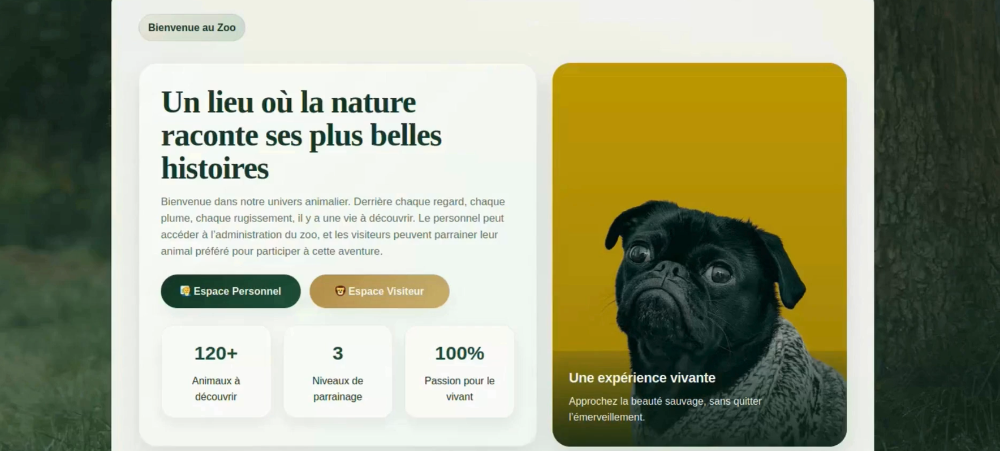
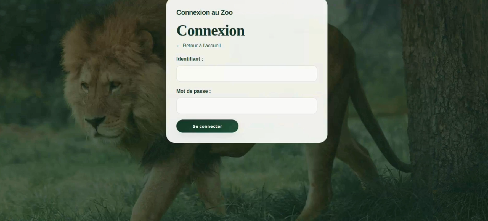
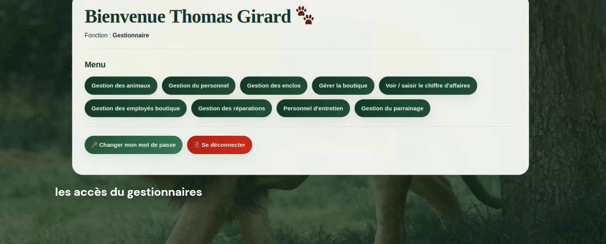
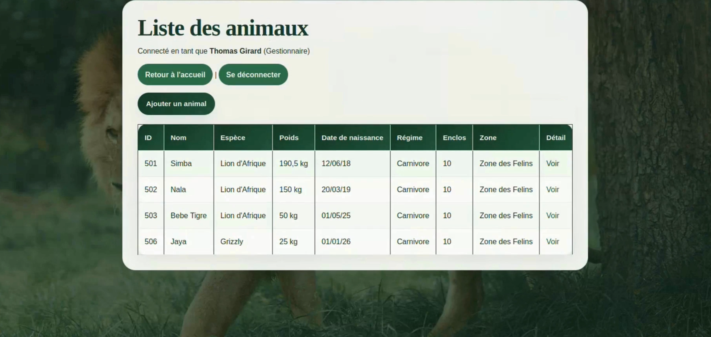
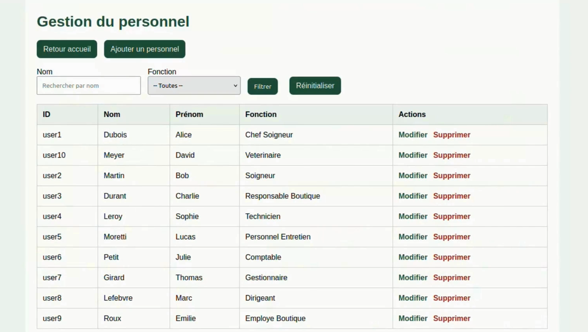

# 🦁 ZooManager — Zoo Management Web Application

> Developed by **Nada Cherine Chetloul**

---

## 📸 Preview

<video src="https://github.com/user-attachments/assets/9dd81e6b-88db-46a3-a901-6482a78f43c6" controls width="100%"></video>

<!-- SCREENSHOT 1: Home page -->

<!-- SCREENSHOT 2: Login page (with menus visible) -->

<!-- SCREENSHOT 3: Home page after login (with menus visible) -->

<!-- SCREENSHOT 4: List of animals -->

<!-- SCREENSHOT 5: A role's interface (e.g. keeper or manager) -->


---

## 🌐 Description

ZooManager is a web application for the internal management of a zoo.  
It lets each staff member access only the features related to their position, thanks to a role and permission system handled in PHP.

The application has two areas:
- **Staff area** — reserved for zoo employees (access with username and password)
- **Visitor area** — lets visitors register an animal sponsorship

---

## 🛠️ Tech Stack

| Element | Technology |
|---|---|
| Back-end | PHP (sessions, OCI, bcrypt) |
| Database | Oracle |
| Front-end | HTML / CSS |
| Security | `password_hash()` / `password_verify()`, parameterized queries |

---

## 🚀 Running the Project

1. Clone the repository
2. Configure the Oracle connection in the configuration file
3. Open in your browser:

```
http://10.1.16.112/~your_login/index.php
```

---

## 🔐 Test Accounts

All accounts use the default password: `monmotdepasse`  
It can be changed at any time from the interface (via `changer_mot_de_passe.php`).

| Username | Role | Access level |
|---|---|---|
| `user8` | Director | Maximum — full access |
| `user7` | Manager | High — operational management |
| `user1` | Head keeper | Medium-high — care & feeding |
| `user10` | Veterinarian | Medium — care follow-up |
| `user2` | Keeper | Medium — care & feeding |
| `user4` | Technician | Limited — repairs & enclosures |
| `user3` | Shop manager | Shop — shop management & revenue |
| `user6` | Accountant | Read-only — revenue only |
| `user9` | Shop employee | Minimal — shop viewing |
| `user5` | Maintenance staff | Very limited — enclosures only |

---

## 🗄️ Database Structure

<details>
<summary>View the main tables</summary>

| Table | Description |
|---|---|
| `personnel` | All employees (login, hashed password, role, area) |
| `animal` | Animals (species, enclosure, weight, diet, lineage) |
| `soigner` | Care interventions (animal, staff, type of care, date) |
| `nourrir` | Feedings (animal, staff, food, date) |
| `boutique` | Zoo shops |
| `employe_boutique` | Link between employees / shops |
| `reparation` | Repairs (nature Small/Large, description) |
| `faite` | Link between repair ↔ enclosure |
| `personnel_technique` | Link between technician ↔ Small repair |
| `realise` | Link between contractor ↔ Large repair |
| `parrainage` | Animal sponsorships (level, benefit) |
| `parraine` | Sponsors (last name, first name) |
| `ca_journalier` | Daily revenue per shop |

</details>

---

## 👥 Roles and Permissions

Each PHP page checks `$_SESSION['fonction']` at the top of the file and redirects if access is not authorized. Here is what each role can do:

<details>
<summary>🔴 Director — maximum access</summary>

Has access to all menus: animals, staff, enclosures, shops, revenue, repairs, sponsorships.  
Can edit and delete staff members, and view sponsorships with filters.

</details>

<details>
<summary>🟠 Manager — operational management</summary>

The only role that can **add**, **edit**, or **delete** staff.  
Can add/edit shops, assign a shop manager, and add animals.

</details>

<details>
<summary>🟡 Head keeper & Keeper — care and feeding</summary>

Can record simple care (vaccination, brushing, cleaning) and feedings.  
If a type of food does not yet exist in the database, it is created automatically.  
No access to staff management or the shop.

</details>

<details>
<summary>🟢 Veterinarian — care follow-up only</summary>

Only has access to the follow-up of **complex** care (examination, surgery, X-ray).  
Everything else is blocked.

</details>

<details>
<summary>🔵 Technician — Small repairs only</summary>

Can only add **Small** type repairs.  
Double protection: the "Large" option is absent from the HTML **and** rejected on the PHP server side.  
Their identifier is automatically pre-filled in the form.

</details>

<details>
<summary>🟣 Shop manager — managing their shop</summary>

Manages the employees of their shop and views the revenue.  
Cannot assign a manager (reserved for the Manager role).

</details>

<details>
<summary>⚪ Accountant, Shop employee, Maintenance staff</summary>

**Read-only** access within their respective scope (revenue, shop, enclosures).  
No data entry or management actions.

</details>

---

## ⚙️ Notable Technical Points

### Authentication (`login2.php`)
1. The username is looked up with `TRIM()` to avoid stray Oracle spaces
2. The password is verified via `password_verify()` against the bcrypt hash in the database
3. Session storage: `id_personnel`, `nom`, `prenom`, `fonction`
4. All protected pages check `isset($_SESSION['id_personnel'])` and redirect otherwise
5. Logout (`logout.php`) calls `session_unset()` + `session_destroy()`

### Parameterized Oracle Queries
All queries use `oci_bind_by_name()`.  
Optional filters follow this pattern:
```sql
WHERE (:param IS NULL OR LOWER(champ) LIKE LOWER('%' || :param || '%'))
```
The empty string is converted to PHP `null` before binding so the filter is ignored automatically.

### Transactions and Rollback (`ajout_reparation.php`)
Adding a repair touches several tables (`reparation`, `faite`, then `personnel_technique` or `realise`).  
The code uses `OCI_NO_AUTO_COMMIT` on each intermediate insert and only calls `oci_commit()` if everything succeeds — otherwise `oci_rollback()`.

### Automatic Food Creation (`ajout_nourrissage.php`)
If the entered food type does not exist yet:
1. A new id is computed via `MAX(id_nourriture) + 1`
2. It is inserted with `dose_journaliere = 0`
3. Then the feeding is inserted normally

This avoids a foreign key error without forcing the user to create the food beforehand.

### Double Technician Protection
The "Large" type is blocked at two levels:
- **HTML**: the option does not appear in the `<select>` (conditional PHP rendering)
- **PHP server**: explicit check — even if the HTML is manipulated client-side, the server refuses

### Handling Oracle Encodings (`Vétérinaire`)
The condition in `accueil.php` tests several spelling variants to handle UTF-8 / Oracle encoding issues:
```php
if ($fonction == "Veterinaire" || $fonction == "Vétérinaire")
```

### Shop Manager Duplicate Prevention (`affecter_responsable_boutique.php`)
Two preliminary `SELECT`s check:
1. That the shop does not already have a manager (`est_responsable = 1`)
2. That the staff member is not already linked to this shop

---

## 📁 Project Structure

```
zoo-manager/
├── index.php
├── login2.php
├── logout.php
├── accueil.php
├── changer_mot_de_passe.php
│
├── animaux/
│   ├── ajout_animal.php
│   └── ...
│
├── personnel/
│   ├── gestion_personnel.php
│   ├── ajouter_personnel.php
│   ├── modifier_personnel.php
│   ├── supprimer_personnel.php
│   └── personnel_entretien.php
│
├── soins/
│   ├── ajout_soin.php
│   ├── soins.php
│   └── ajout_nourrissage.php
│
├── boutique/
│   ├── boutique.php
│   ├── ajouter_boutique.php
│   ├── modifier_boutique.php
│   ├── employes_boutique.php
│   ├── affecter_responsable_boutique.php
│   └── ca.php
│
├── reparations/
│   ├── ajout_reparation.php
│   └── enclos.php
│
└── parrainage/
    └── parrainage_gestion.php
```

---

## 📷 Screenshots to Add

Place your screenshots in a `screenshots/` folder at the root of the repo:

| File | What it should show |
|---|---|
| `screenshots/accueil.png` | Home page after login with menus visible |
| `screenshots/animaux.png` | List of animals (table with real data) |
| `screenshots/espace-personnel.png` | Logged-in view of a role (e.g. manager) |
